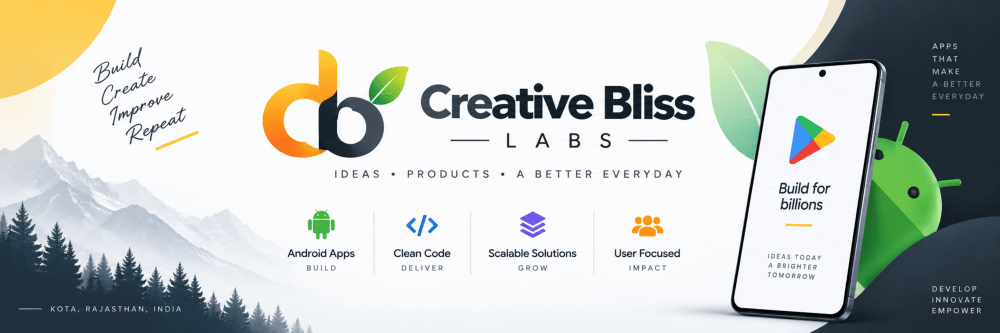
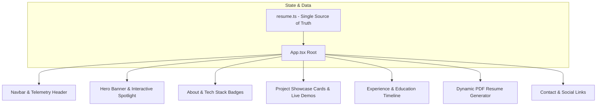

# 🌐 Manpreet Singh — Interactive 3D Portfolio & Developer Showcase

<p align="center">
  
</p>


[](https://i-am-manu-singh.github.io/PortfolioWebsite/)
[](https://react.dev/)
[](https://www.typescriptlang.org/)
[](https://vite.dev/)
[](https://tailwindcss.com/)
[](https://www.framer.com/motion/)

> **Live Deployment:** [https://i-am-manu-singh.github.io/PortfolioWebsite/](https://i-am-manu-singh.github.io/PortfolioWebsite/)

**Manpreet Singh's Official Portfolio** is an interactive, cinematic developer portfolio crafted with **React 19**, **TypeScript**, **Vite**, **Tailwind CSS**, and **Framer Motion**. Designed with dark cyberpunk aesthetics, glassmorphism telemetry, and fluid micro-animations, it spotlights production-grade engineering across **Kotlin Multiplatform (KMP)**, **Android Native (Jetpack Compose)**, and **React Native / Expo** ecosystems.

---

## 📑 Table of Contents
1. [Overview & Highlights](#-overview--highlights)
2. [Key Portfolio Features](#-key-portfolio-features)
3. [Architecture & Component Structure](#-architecture--component-structure)
4. [File & Directory Structure](#-file--directory-structure)
5. [Tech Stack & Dependencies](#-tech-stack--dependencies)
6. [Getting Started & Local Development](#-getting-started--local-development)

---

## 🌟 Overview & Highlights

- **Interactive Project Showcases**: Deep dive into real-world applications (pEQ Workstation, Signy Tactical, Moonlight Webcam, Radel Tanpura, TallyPlugin).
- **Dynamic PDF Resume Generator**: On-the-fly client-side export of a high-resolution CV powered by `html2canvas` and `jsPDF`.
- **Telemetry & Skill Matrices**: Real-time stats on 250+ solved LeetCode DSA problems, Android system design, JNI/NDK, audio DSP, and cloud architecture.
- **Glassmorphic Cyberpunk DNA**: High-framerate fluid cursor gradients, spotlight hover states, and smooth spring physics.

---

## 🚀 Key Portfolio Features

### 💻 Featured Engineering Projects
- **pEQ Learn & Neural Media Player**: Multi-track stem isolation, 88-key synthesia piano, and DSP telemetry.
- **Signy Tactical KMP**: Real-time asset tracking, WebRTC live feeds, and Supabase security infrastructure.
- **Moonlight Webcam**: Wireless RTSP and MJPEG camera streaming suite for mobile and desktop.
- **ReconcAILe Hub (TallyPrime)**: Automated bank reconciliation, OCR invoice processing, and desktop bridge.
- **Trip India & Hostel Shop**: High-density Flutter provisioning and expedition command portals.

### 📄 One-Click Resume Generator
- Live downloadable formatted PDF resume directly from the browser without server roundtrips.

### 📬 Direct Connection Portal
- Embedded contact terminal with interactive social badges (LinkedIn, GitHub, LeetCode, Email).

---

## 🏛 Architecture & Component Structure

The frontend leverages a modular component structure optimized for Vite tree-shaking and zero-latency rendering:



---

## 📂 File & Directory Structure

```text
PortfolioWebsite/
├── package.json                          # Dependencies & NPM scripts
├── vite.config.ts                        # Vite bundler configuration
├── tailwind.config.js                    # Custom cyberpunk palette & tokens
├── tsconfig.json                         # Strict TypeScript configuration
├── public/                               # Static assets, favicon, preview images
└── src/
    ├── main.tsx                          # React 19 application mount
    ├── App.tsx                           # Top-level layout & view orchestrator
    ├── index.css                         # Global CSS, utilities & custom glow effects
    ├── components/                       # Modular UI components (Navbar, Hero, Projects, etc.)
    ├── data/                             # Single source of truth resume & project datasets
    ├── hooks/                            # Custom interaction & scroll-observer hooks
    └── utils/                            # PDF export logic & formatters
```

---

## 🛠 Tech Stack & Dependencies

| Technology | Purpose |
|---|---|
| **React 19** | Ultra-performant reactive component model |
| **TypeScript 5.9** | Strict type safety across all project models |
| **Vite 7.2** | Instant Hot Module Replacement (HMR) and optimized rollup bundle |
| **Tailwind CSS 3.4** | Utility-first responsive styling and curated dark gradients |
| **Framer Motion 12.2** | Smooth spring animations, staggered reveals, and scroll triggers |
| **Lucide React** | Crisp, lightweight modern icon suite |
| **html2canvas & jsPDF** | Client-side DOM-to-PDF vector generation |

---

## 💻 Getting Started & Local Development

```bash
# Clone the repository
git clone https://github.com/I-am-Manu-Singh/PortfolioWebsite.git

# Install dependencies
npm install

# Start local development server
npm run dev

# Create optimized production build
npm run build
```

---

## 👤 Author
**Manpreet Singh** ([@I-am-Manu-Singh](https://github.com/I-am-Manu-Singh))  
*Software Development Engineer & Mobile Specialist*


---

## 📱 App Screenshots

<p align="center">
  <table>
    <tr>
      <td align="center" width="25%">
        <br />
        <b>1. Main Screen</b>
      </td>
      <td align="center" width="25%">
        <br />
        <b>2. Core Experience</b>
      </td>
      <td align="center" width="25%">
        <br />
        <b>3. Interactive Mode</b>
      </td>
      <td align="center" width="25%">
        <br />
        <b>4. Advanced Features</b>
      </td>
    </tr>
    <tr>
      <td align="center" width="25%">
        <br />
        <b>5. Workflow / Details</b>
      </td>
      <td align="center" width="25%">
        <br />
        <b>6. Studio Console</b>
      </td>
      <td align="center" width="25%">
        <br />
        <b>7. Settings & Config</b>
      </td>
      <td align="center" width="25%">
        <br />
        <b>8. Dark & Light Theme</b>
      </td>
    </tr>
  </table>
</p>
